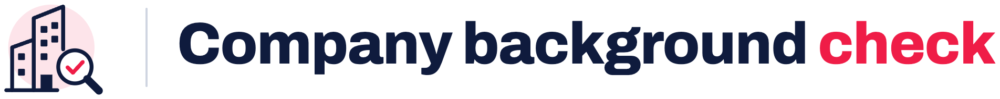
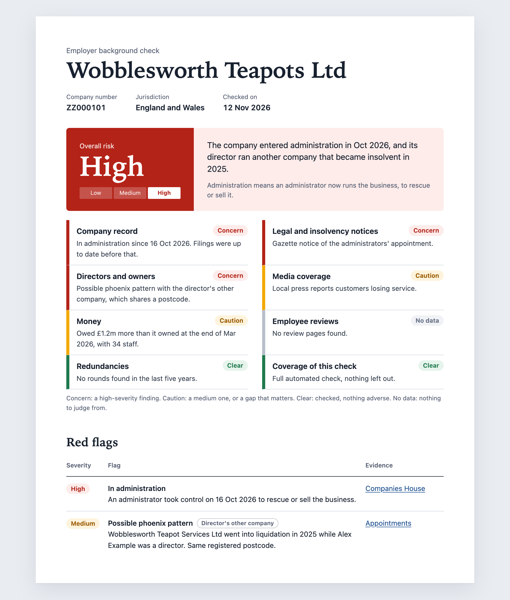
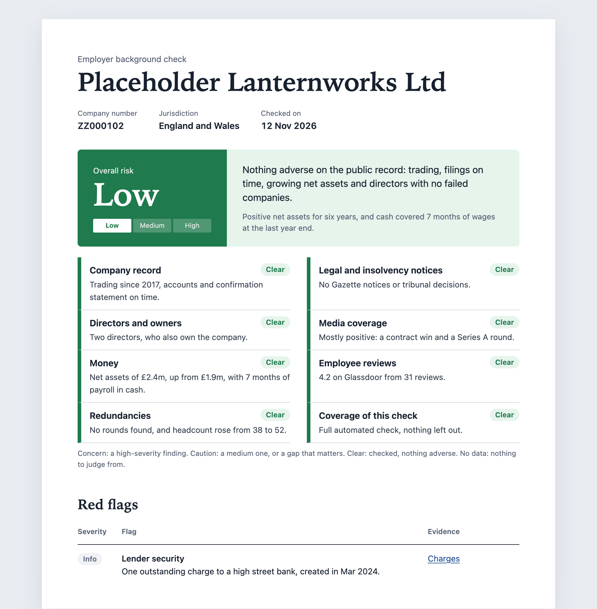

<h1>
  <picture>
    <source media="(prefers-color-scheme: dark)" srcset=".github/logo-dark.png">
    
  </picture>
</h1>

[](https://skills.sh/terdelyi/company-background-check)

An agent skill that runs a background check on a UK company from the point of view of someone who works there, or is thinking about it. Give it a company name or number and it produces a printable HTML report with a risk rating and scorecard at the top and the evidence underneath. It works with Claude Code, Codex, Cursor and other agents that support skills.

<p>
  
  
</p>

## What it checks

- **Companies House:** status, filings, charges, insolvency history, directors and owners
- **Directors and owners:** phoenix companies, companies opened and closed in quick succession, and the disqualified directors register
- **Accounts:** net assets, short-term debts, cash, headcount and turnover for up to five years, and going-concern warnings. Accounts filed as PDF are read by the agent, scanned ones too on macOS
- **Parent companies:** followed up to the UK parent
- **The Gazette:** winding-up petitions and other insolvency notices
- **Employer registers:** employment tribunal decisions, gender pay gap filings, the visa sponsor register and payment practice reports
- **Court judgments:** judgments of the High Court and the courts above it on Find Case Law that name the company as a party
- **IR35 size:** whether the company counts as small, for contractors
- **The web:** funding, redundancies, press coverage, minimum wage and pension penalty naming, and employee reviews

Every flag links to its evidence. Anything matched on a name alone is reported as a lead to verify, never as a finding.

## Install

Claude Code, Codex, Cursor and other agents:

```bash
npx skills add terdelyi/company-background-check -g
```

claude.ai: zip the `skills/company-background-check` folder and upload it under Settings → Capabilities → Skills.

## Setup

You need Node 22 or later (nothing to install) and a free Companies House API key. Sign in or register on the [Companies House developer hub](https://developer.company-information.service.gov.uk/manage-applications), create a live application and add a REST key to it, then make it available as `COMPANIES_HOUSE_API_KEY`. In Claude Code, add it to `~/.claude/settings.json`:

```json
{
  "env": {
    "COMPANIES_HOUSE_API_KEY": "your-key-here"
  }
}
```

Other agents need it in the environment their shell commands run in.

Without a key the skill falls back to the public Companies House pages, which is slower and less complete.

## Use

Ask your agent, for example "check this company before I accept the offer". In Claude Code you can also run `/company-background-check <company name or number>`. The registered name or company number works best, because many companies trade under a different name.

## Limits

- UK companies only.
- Glassdoor and LinkedIn have no public API, so reviews are often missing.
- County court judgments are not checked. They are on a paid register, and the report suggests the search when the risk calls for it.
- Each run downloads about 120 MB of public register data, most of it the payment practices file.
- The report is put together by an AI from public sources. It can miss things or get them wrong, and it is not legal or financial advice. Check anything important at the source before you act on it.

## Keep reports private

A report puts real companies and real people's names next to risk flags. The skill is written to state only what public records show and to label name matches as leads, but a report is still a private working note for your own decision. It never publishes one for you. If you share a report or quote it publicly, you are responsible for what you publish, including under the law of defamation. Check every claim at its source first, and leave out people's names unless you need them.

## Contributing

See [CONTRIBUTING.md](CONTRIBUTING.md) for the tests and the rules on test data.

## License

MIT, see `LICENSE`.
